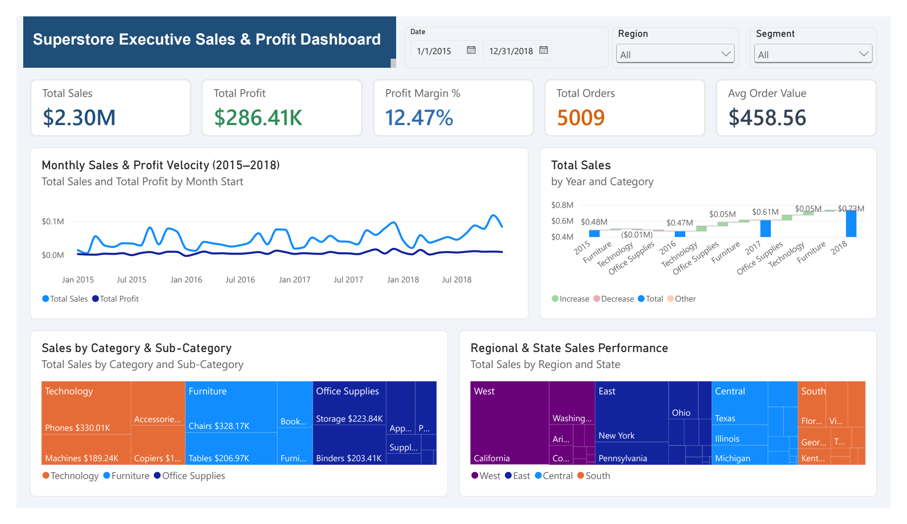
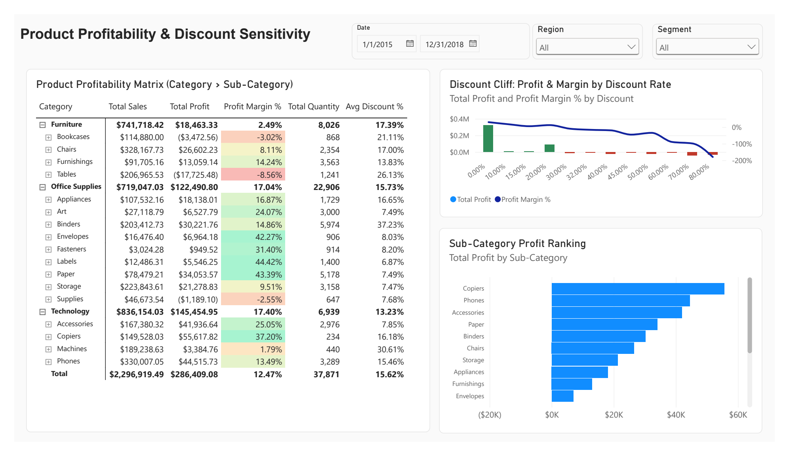
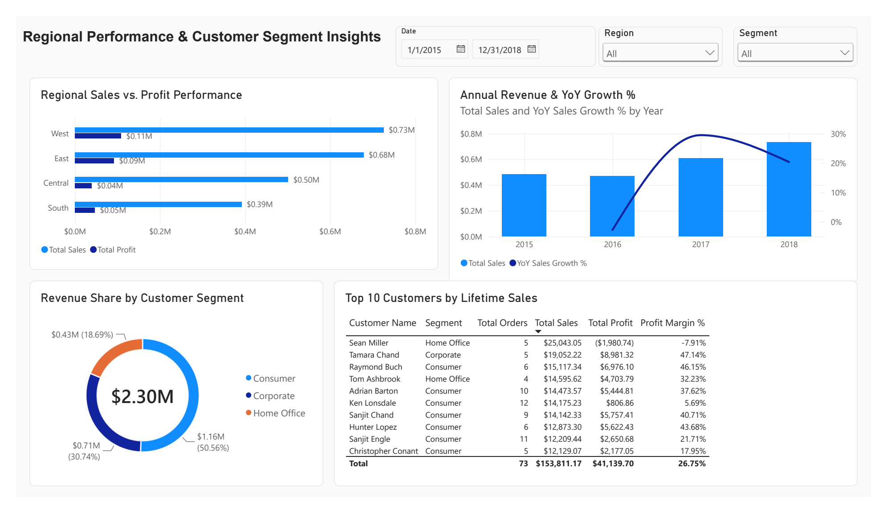

# Task 2: Interactive Power BI Executive Sales & Profit Dashboard

> **Status:** ✅ Completed

## Deliverables
- [`superstore_executive_dashboard.pbix`](./superstore_executive_dashboard.pbix) — Interactive 3-page Power BI Desktop dashboard
- [`executive_dashboard_report.pdf`](./executive_dashboard_report.pdf) — Exported high-resolution executive report
- [`screenshots/`](./screenshots) — Rendered PNG previews of all 3 dashboard pages

---

## Data Model (Star Schema)
- **Fact Table:** `Fact_Orders` (9,993 deduplicated order line items from `superstore_sales.csv`)
- **Dimension Tables:**
  - `Dim_Customer` (`Customer ID`, `Customer Name`, `Segment`)
  - `Dim_Product` (`Product ID`, `Category`, `Sub-Category`, `Product Name`)
  - `Dim_Date` (`Date`, `Year`, `Quarter`, `Month Number`, `Month Name`, `Year-Month`, `Month Start`)
  - `Dim_People` (`Region`, `Regional Manager`)
- **Measure Table:** `_Measure` (`Total Sales`, `Total Profit`, `Total Orders`, `Total Quantity`, `Profit Margin %`, `Avg Order Value`, `Avg Discount %`, `Sales PY`, `YoY Sales Growth %`)

---

## Dashboard Pages Preview

### Page 1 — Executive Overview

### Page 2 — Product Profitability & Discount Sensitivity

### Page 3 — Regional Performance & Customer Segment Insights

